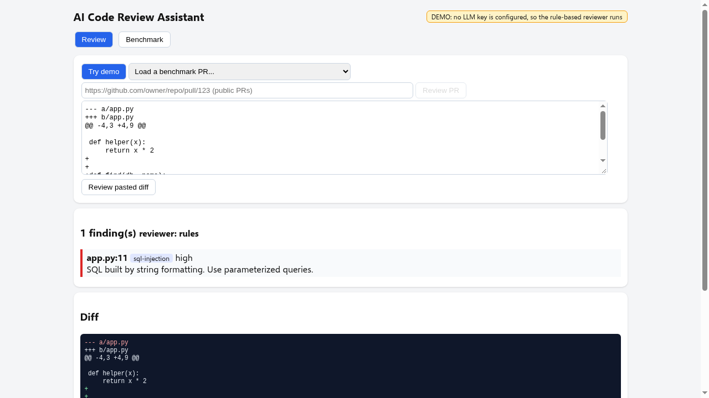
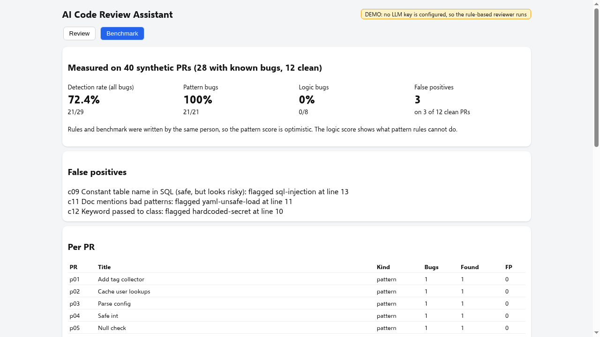
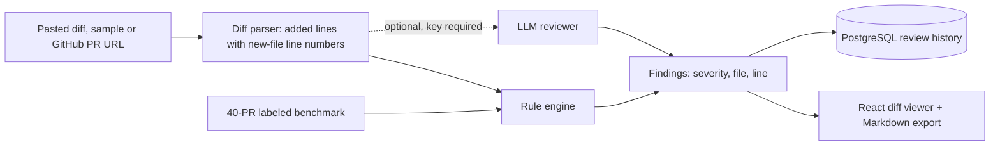

# AI Code Review Assistant

[](https://github.com/ZeyadMohamed00/ai-code-review-assistant/actions/workflows/ci.yml)

Reviews a pull request diff and flags likely bugs on the exact changed line. Paste a diff, load a sample, or give a public GitHub PR URL.

**Live app:** https://codereview-web.vercel.app (API docs: https://codereview-api.vercel.app/docs). "Review sample PR" reviews a sample PR with a SQL injection bug. The Benchmark tab re-runs the reviewer on the bundled PRs live.




The review page shows findings inline under the flagged diff line, with a severity filter and Markdown export. History entries made in the same browser can be reopened.

## System overview


**Tech stack:** Python, FastAPI, React, TypeScript, PostgreSQL, httpx, Pytest, Vitest, Docker.

## Stack
Python, FastAPI, PostgreSQL (review history), GitHub API (httpx), React + TypeScript (Vite), GitHub Actions (workflow files in `.github/workflows/`), optional LLM API.

## Status, honestly
- **No LLM was used.** The LLM reviewer (`cr/llm.py`, OpenAI-compatible, enabled by `OPENAI_API_KEY`) is written but was **never run**: no key was available. Everything measured below is the **rule-based reviewer** only.
- Posting review comments to GitHub (`cr.github.post_review`) is written and tested with a mocked transport only. It was never run against GitHub, and the public demo has no token, so it only reads.
- Fetching a public PR diff from GitHub was run live (unauthenticated, rate-limited).
- GitHub Actions files are in `.github/workflows/` (the push token lacked `workflow` scope). Never run on GitHub.

## Evaluation (real run: `python eval/run_eval.py`, output in `eval/results.json`)
40 synthetic PRs written by hand: 20 PRs with 21 well-known bug patterns, 8 PRs with logic bugs that have no pattern, 12 clean PRs, including look-alikes meant to trigger false positives.

| Metric | Result |
|---|---|
| Detection rate, all 29 known bugs | **72.4%** (21/29) |
| Pattern bugs | 100% (21/21) |
| Logic bugs | **0%** (0/8) |
| False positives | **3**, on 3 of 12 clean PRs (precision 87.5%) |

What this does and does not mean:
- The author wrote both the rules and the PRs, so **100% on pattern bugs is optimistic**. It shows the rules work as designed, not that they generalize.
- The 0% on logic bugs is the real limit of pattern rules (off-by-one, wrong operator, swapped arguments). That is the gap an LLM reviewer is meant to fill, and this repo does not show that it does.
- The 3 false positives are kept, not tuned away: a constant table name in an f-string SQL, a bad pattern named inside a string, and `password_hint="..."` flagged as a secret.
- "Detected" means a finding with the right category on the exact changed line.
- Not measured: real-world PRs. Only a smoke check on one real public PR (no findings, not labeled).

## Run
```
docker compose up --build            # API :8000
pip install -r requirements.txt && DATABASE_URL=postgresql+psycopg2://... uvicorn cr.main:app
cd frontend && npm install && npm run dev
pytest -q && python eval/run_eval.py && cd frontend && npm test
```

## How it works / key decisions
- `cr/diffparse.py` reads a unified diff and keeps only **added lines with their line number in the new file**, so a finding points at the line the author wrote.
- `cr/rules.py` runs regex rules on added `.py` lines only (comments skipped). A few rules look ahead a few added lines (`except:` then `pass`, `requests.get(` then `timeout=`).
- The benchmark diffs are generated with `difflib` from before/after files, so line numbers are exact and expected lines are found by text, not typed by hand.
- LLM findings (if a key is set) are tagged `source: llm` and merged with rule findings, so the two can be compared.
- PR URLs are matched against a strict `github.com/<o>/<r>/pull/<n>` pattern before any request (no arbitrary URL fetching).

## Key concepts
1. Why only added lines and new-file line numbers matter in a diff.
2. What a pattern rule can and cannot see (syntax patterns, not meaning).
3. How detection rate and false positives are counted here, and why 100% on your own test set proves little.
4. Why logic bugs scored 0% and what an LLM would add.
5. What is unproven: the LLM path, posting comments to GitHub, and the Actions workflows.

## Accounts and persistence
- **Real accounts:** `POST /auth/register`, `POST /auth/login`, `GET /auth/me`. Passwords are salted PBKDF2-SHA256 hashes; sessions are signed JWTs (7 days) sent as `Authorization: Bearer`. Set `JWT_SECRET` in production; if it is unset, a demo-only secret is derived from `DATABASE_URL` and a warning is logged.
- **Persistence:** a signed-in user's data is stored in PostgreSQL under their own account key (`user:<id>`) and is only reachable with their token. New accounts start empty.
- **Guest session:** without logging in, "Explore without signing up" uses an anonymous browser id with clearly labeled sample data. Guest ids can never collide with or impersonate an account.
- Tests: `tests/test_auth.py` (register, login, wrong or weak password, duplicate email, bad token, isolation) and `frontend/src/auth.test.tsx`.
- Login is throttled: 5 wrong passwords per email in 5 minutes returns `429` with `Retry-After` (`LOGIN_MAX_FAILS`, `LOGIN_FAIL_WINDOW_S`). The counter lives in process memory, so on several instances or serverless functions each one counts separately; use a shared limiter for hard guarantees. With `APP_ENV=production` a missing `JWT_SECRET` stops the app at startup instead of falling back.
- Not built: email verification, password reset and refresh tokens (listed as next steps).

## Database migrations

Schema changes are versioned with Alembic (`migrations/`, baseline `0001`). Point `DATABASE_URL` at the database and run `alembic upgrade head`. The baseline was generated from the models and checked by running upgrade, downgrade and upgrade again on SQLite; I did not run it against a fresh PostgreSQL instance here. The running app still creates missing tables on start.

## Per-category results (real run, `python eval/run_eval.py`, in `eval/results.json` under `per_category`)
Every pattern category the rules cover has recall 1.0 on this set (each has 1 to 3 cases, so this is a small sample). Precision is below 1.0 for three categories: `sql-injection` 0.75, `hardcoded-secret` 0.667 and `yaml-unsafe-load` 0.5, each from false positives on the clean PRs listed in `false_positive_list`. The 8 `logic` bugs are all missed by the rule reviewer (recall 0.0): rules cannot see logic errors, which is the gap the unrun LLM reviewer is meant to fill. The dataset is written by the project author, so these figures are a regression check, not a measure of real-world performance.
